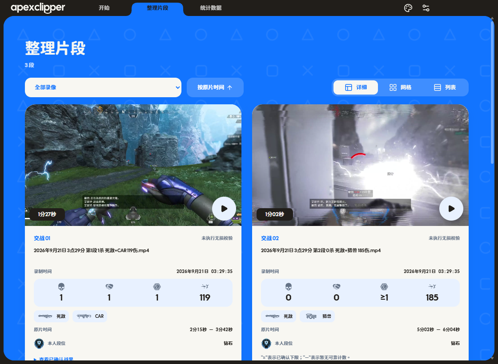
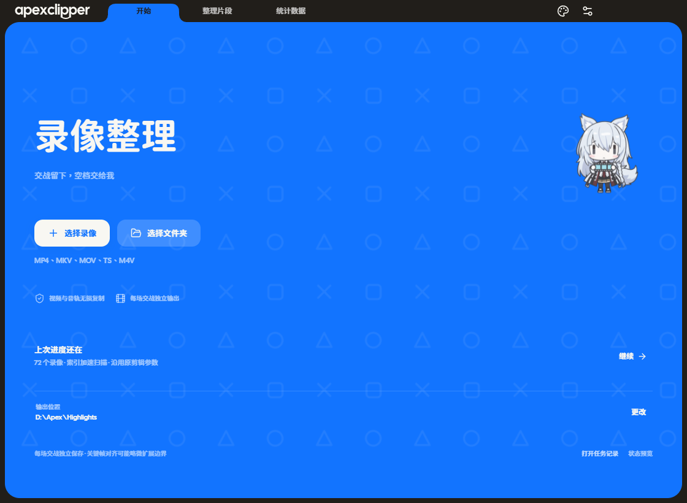
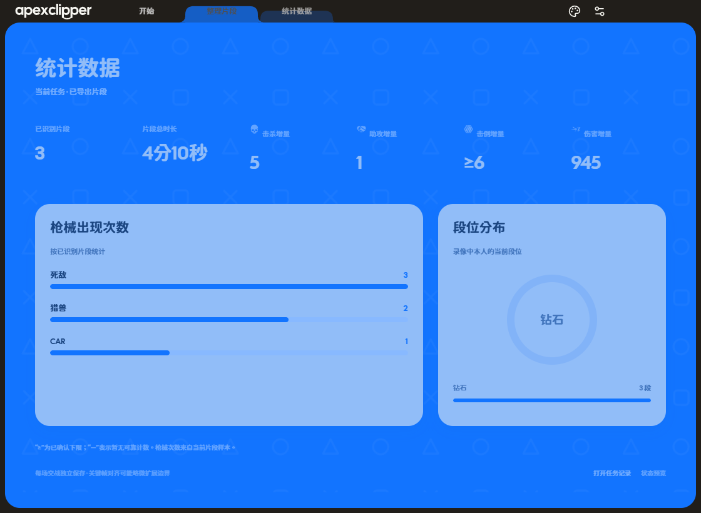
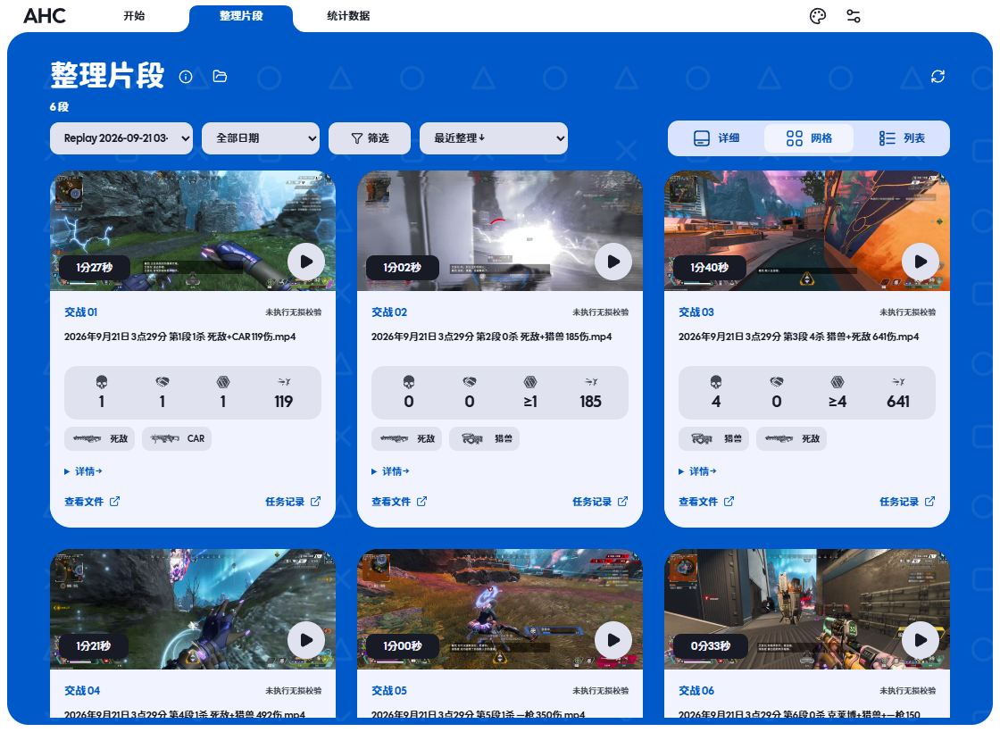
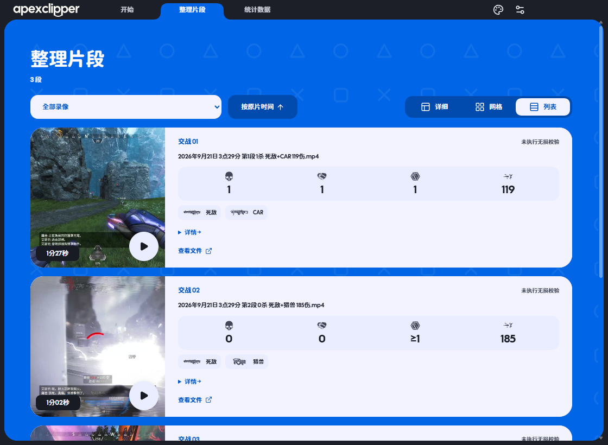

# AHC · Apex Highlight Clipper

把一晚上的 Apex 录像丢进去，它自己找出每一场交战，剪成一段段 MP4。
画面不重编码，所有音轨照原样保留。装完就能用，不用另装 Python、Node.js 或 FFmpeg。

[下载 Windows 版](https://github.com/LilycleHeart/apex-highlight-clipper/releases/latest) · [使用指南](docs/user-guide.md) · [开发说明](docs/development.md) · [第三方资源](docs/third-party.md)

  



<table><tr><td></td><td></td></tr><tr><td></td><td></td></tr></table>

以上都是运行时截下来的，不是设计稿。画面里的战绩和缩略图取自验证用的已导出片段样本。

## 上手三步

1. 运行 EXE 安装包，或者把便携 ZIP 完整解压到一个可写目录，双击 **Apex Highlight Clipper.exe**。
2. 把录像或文件夹拖进窗口，选好输出位置。默认放在系统"视频"目录下的 Apex Highlight Clipper 文件夹。
3. 点"开始整理"。中途停止会保存断点，下次接着跑。

安装是当前用户级的，不需要管理员权限。安装包已带 CPU / DirectML 的 Python 运行环境和 OCR 模型；便携包最外层只有启动 EXE 和 `resources`，建议整个目录一起保留，单独拷 EXE 会缺依赖。FFmpeg 9.0.2 装一份就够，各版本共用，之后升级不用重新下载。

## 它能做什么

- **识别方向对**：拉扯很久、TTK 偏长、甚至你倒地后队友接着打的战斗，都能剪出来。
- **只留你自己的战果**：一场交战中至少要有你的一次击倒、助攻或消灭。只有伤害、没打中的候选才会跳过，而且要在识别校准完成、候选画面覆盖完整的前提下；拿不准的一律留给你复核。
- **每场交战一段 MP4**：直接用 FFmpeg 复制流，不重编码、不拼成一条长视频；起点会因为对齐关键帧略向外扩一点。
- **全局片段库**：打开软件就能看到以前剪过的片段，自动汇总去重，不用先去翻任务记录。
- **自动适配 HUD**：读取录像分辨率和画面比例，区分普通与 4:3 拉伸布局。认不出布局时会明确报"识别失败"，不会假装成功却没成片。
- **三种视图 + 应用内播放**：详细卡片、紧凑网格、列表共用排序和选中状态；在同一片段库里播放，保留筛选和浏览位置，也可切换宽屏或全屏。
- **可筛选**：按账号、队友、英雄、武器、模式/段位、来源、日期和战绩筛选；详情字段可以直接点击筛选，武器按弹药分组、英雄按定位分栏。
- **回收片段**：删片段要连点两次确认，删除进系统回收站，可以恢复。原录像不会从这个入口删掉，跑任务时按钮锁定。
- **日期与排序**：「最近整理」使用日期时间轴；选择录像时间、伤害或击杀时，按当前全部筛选结果排序，升降序单独切换。
- **QQ 分享**：单段或多选片段一次打开 QQ 会话选择窗口，选择联系人后再发送。
- **断点续接**：任务中断后接着跑，参数和算法版本按原任务冻结，已经导出的不重复导出。

## 想调参数

首页的"整理选项"里都能改，默认值如下。

| 选项 | 默认 | 说明 |
| --- | --- | --- |
| GPU 负载 | 低占用 | 低占用 / 均衡 / 全速。控制工作节奏，不是固定的占用率上限 |
| 细查频率 | 2 帧/秒 | 独立于源视频帧率，新任务最低 1 帧/秒 |
| 合并间隔 | 10 秒 | 相隔不超过这个时间的交战算一场 |
| 前后保留 | 各 6 秒 | 按你的拉扯节奏调 |
| 按战绩过滤 | 关闭 | 开启后可设最低击杀 / 时长 / 伤害 / 助攻，0 表示不限 |
| 导出存放 | 每次单独文件夹 | 也可选全部放同一个文件夹，文件名会加短标识防止覆盖 |
| 导出后移至回收站 | 关闭 | 只回收成功导出且成片完整的原录像；没成片、导出失败、缺片或源文件变过都不动 |
| 整理时补充 HUD | 关闭 | 可选账号、武器、队友、英雄、段位，也可以在片段库事后补 |

觉得某个录像剪多了或剪少了，先动"合并间隔"和"前后保留"。

## 数据都在本地

输出文件夹里只有成片 MP4，不会混进记录文件。任务记录、分析缓存、封面和配置都在软件的用户数据目录里；这些都不进发布包。

程序不联网上传录像。唯一的联网行为是：下载 FFmpeg（只在本地确实没有可用副本时）、检查更新、以及你在设置里主动点"下载并安装"时校验安装包 SHA256。发布包没有代码签名证书，所以 Windows 可能提示未知发布者；包内附 SHA256SUMS.txt 和逐文件清单，可以自己核对。

## 怎么看识别结果

战绩栏沿用游戏里的图形，依次是**击杀 / 助攻 / 击倒 / 伤害**，鼠标悬停有中文说明。数字的三种写法含义不同：

- **数字**：这段区间里可靠确认的增量。
- **≥2**：至少确认了 2 次，但证据不足以给出完整总数。
- **—**：暂时没有可靠读数，不会把缺失填成 0。

打完全场（出现结算画面）就优先用结算数字；没截到结算画面，就看画面中下方你自己的战绩提示。段位读不出来会显示"未识别"。统计页的"常玩"数据按对局去重，表示已识别样本中的出现次数，不是账号完整生涯数据。

## 适配范围与已知限制

画面比例和 HUD 布局目前验证过三种：超宽、1920×1080 普通 HUD、4:3 拉伸。除这三种，其他比例或布局可能不准，需要拿真实录像校准。硬件解码在 NVIDIA CUDA 路径上验证过，其他显卡可以退回 CPU 解码和识别。

索引加速是唯一的识别方式，它对录像有要求：起始时间戳为零的 H.264 MP4 / MOV。OBS 直接录的 mp4 一般没问题；万一某个录像读不出索引，把它重新封装成 mp4 再试。

这是本地视觉识别，画面完全遮住战绩时没法恢复不存在的证据。阈值判断对未知值和已确认下限一律保守，宁可留"待核验"也不编数。所以有些片段战绩不全，是设计如此，不是坏掉了。

## 界面与个性化

三页导航，圆体排版。明暗主题可切浅色、深色、跟随系统；主色用取色器随意换，会自动配好明暗前景色。角色形象默认关闭，可以开启（带消失 / 复原音效）。开启"减少动态效果"后直接跳到终态。

## 出问题时

日志在软件数据目录的 `logs/` 里，单文件最多 1 MB，保留最近 7 天。要反馈问题：

打开"剪辑设置 → 诊断与反馈"，点"导出诊断包"存一个 ZIP，再点"提交问题"，把 ZIP 拖进 GitHub 反馈描述框，附上现象、发生时间和复现步骤。诊断包会隐去本机路径，不含录像、封面和 HUD 账号识别结果。

补充识别怎么选、回收站怎么恢复、更新失败怎么查、HUD 认不出来怎么办，都在[使用指南](docs/user-guide.md)里。

## 从源码运行

需要 Python 3.11、Node.js 24，以及 FFmpeg / FFprobe。

```powershell
python -m venv .venv
.venv\Scripts\pip install -r requirements.txt
python setup_weapon_model.py           # 下载并校验 OCR 模型
.\scripts\setup-ffmpeg.ps1             # 准备固定版本工具

cd electron-ui
npm ci
npm run build
npm start
```

要用 GPU 的话先跑 `.\setup_gpu.ps1` 建独立的 `.gpu-venv`，它和 CPU 环境互不干扰。已有 FFmpeg 安装可以用 `APEX_FFMPEG_DIR` 指过去。

Python 回归：`python -m unittest discover -p "test_*.py"`；界面回归：在 `electron-ui/` 里 `npm run validate`。发布用的完整运行包由 `scripts/build-portable.py` 收集内核、模型、运行环境和许可证，具体约定见[开发说明](docs/development.md)。

## 许可

本项目是非官方社区工具，与 EA / Respawn 没有隶属关系。第三方字体、模型、游戏图形和角色素材各自遵循原许可，详见[第三方资源](docs/third-party.md)。
