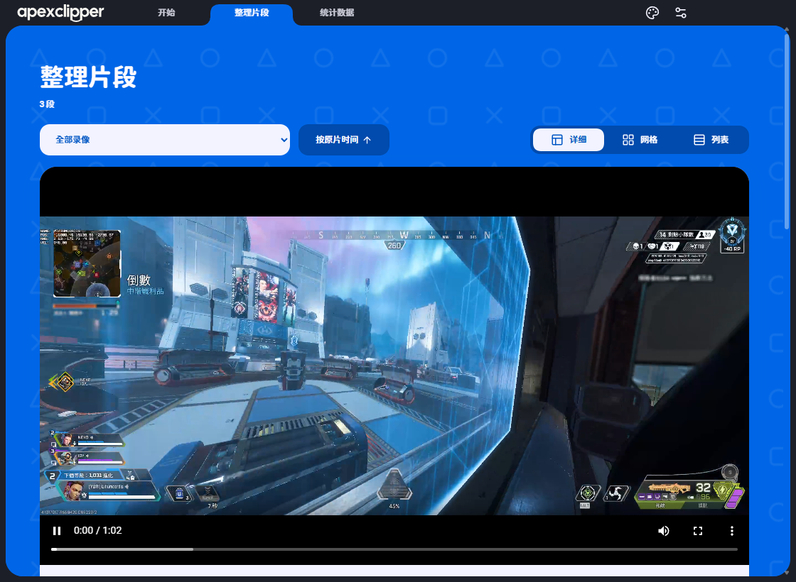
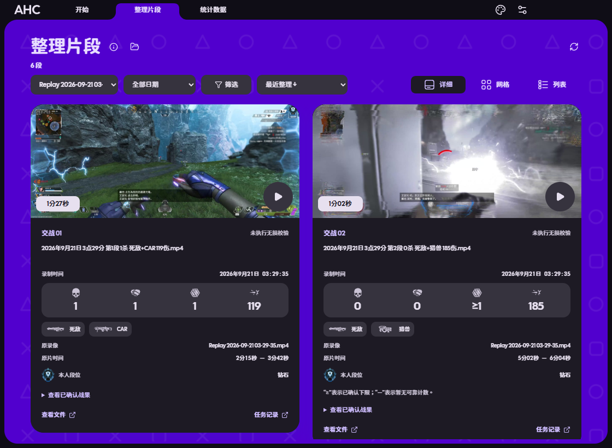

# AHC · Apex Highlight Clipper

**交战留下，空档交给我。**

本地批量识别 Apex Legends 交战 · 每段独立输出 · 视频与全部音轨无损复制

[下载 Windows 版](https://github.com/LilycleHeart/apex-highlight-clipper/releases/latest) · [开发说明](docs/development.md) · [第三方资源](docs/third-party.md)

  

<table><tr><td></td><td></td></tr><tr><td></td><td></td></tr></table>

以上为实际 Electron 应用截图。战绩和缩略图来自验证用的已导出录像，展示的是当前片段样本。

## 下载即用

当前正式版本为 **v1.0.13**，可在 [Releases](https://github.com/LilycleHeart/apex-highlight-clipper/releases/latest) 下载安装包或便携包。

1. 运行 EXE 安装包，或将便携 ZIP 完整解压到可写目录。
2. 安装版从开始菜单启动；便携版双击 **Start.cmd**。包内已附 CPU / DirectML Python 运行环境和 OCR 模型，无需另装 Python 或 Node.js。
3. FFmpeg 9.0.2 各版本共用，存放于 `%LOCALAPPDATA%/Apex Highlight Clipper/dependencies/ffmpeg/9.0.2`。旧版工具可迁移复用；确实没有可用副本时才下载并核对固定 SHA256。EXE 安装包附带离线工具。升级应用不会重新下载同一版本 FFmpeg。
4. 选择录像或文件夹，设置输出位置，点击“开始整理”。停止时保存断点，下次继续原批次。

支持 Windows 10 / 11 x64。GPU 使用 DirectML，默认低占用；识别设备可以改为 CPU。发布包未签名，附 SHA256SUMS.txt 及包内文件校验清单。程序不会上传录像。

## 交战与片段

- **最新索引算法默认启用**：关键帧定位、区间细查、伤害 / 击杀终值审计和本人战果提示共同判断，支持拉扯、长 TTK 和本人倒地后的队友续战。
- **按本人战果保留**：至少确认击倒、助攻或消灭之一；只有伤害的候选跳过，矛盾或无法确定的候选留待复核。
- **每场交战一段 MP4**：FFmpeg stream copy，不重编码、不合并成长视频。保留全部音轨，关键帧对齐可能略向外扩展起止时间。
- **队列处理用时**：每个录像分别显示用时，正在处理时每秒更新，完成或停止后冻结。等待和暂停不计时，续接累计此前用时；软件数据目录保存计时，历史已完成录像使用已有阶段统计补显示。
- **全局历史库**：启动直接聚合已知输出目录与历史任务，去重并保留追溯信息；支持最近整理、录像时间新旧、伤害和击杀排序，以及来源、日期和独立浏览条件，不必先打开任务记录。无法读取的记录可重试或忽略；忽略状态保存在软件索引中，重启后跳过，原记录保留。
- **自动适配 HUD**：读取录像分辨率，通过少量定位画面区分普通与 4:3 拉伸 HUD；交战、战绩及可选信息使用同一套布局坐标。
- **固定 HUD 与名称共识**：枪名采用独立窄行批次与已知武器词表，补回导出前的枪名识别步骤；语音图标不进入玩家名。可选信息最多检查六帧，模糊时在清晰 HUD 附近补读；本人账号按原录像统一弱拼写变体，队友按同一局确认，敌人名称以重复读数为准，无法确认时不展示错误姓名。
- **补充识别独立运行**：GPU 补充 HUD 异常时由独立 CPU 进程续接；已导出视频和主批次保留。停止任务会同时结束补充子进程，五项信息全开时允许英雄、段位为空。
- **统一筛选**：在片段库的“筛选”面板中按本人账号、武器、来源、日期和战绩条件筛选。
- **可选信息补充**：账号、武器、队友、英雄与段位独立于交战识别。默认关闭；首页导入按钮下的两个紧凑开关分别控制 HUD 和过滤，开启后出现三角按钮，手动点击才展开追加选项。可在整理时选取字段，或稍后对已导出片段使用“补充 HUD”；原录像已删除也能追加，视频与既有战绩保持不变。
- **HUD 补充模式**：“未识别片段”只补所选信息中缺失或未确认的字段，保留已确认结果；“重新识别”重新读取所选信息并替换已有结果，无法确认时显示符号。两种模式都支持当前筛选范围或当前播放片段，未选字段保留，视频与既有战绩不变。
- **HUD 补充进度**：显示整个所选范围的完成数量、百分比、当前片段、正在识别的字段与画面检查进度；切换录像时整体计数不归零。播放器随窗口与面板尺寸等比例适配可用视口，控件和战绩使用半透明胶囊背景，“收起”位于全屏按钮旁；不同目标的结果标记分别回看各自过程。整理片段标题旁的文件夹按钮打开当前视频输出目录。
- **名称识别与归一**：名字预处理视图独立保持比例，边缘留出余量；语音图标按多个尺寸定位并裁除，战队标签从识别、筛选与统计中去掉。同一录像本人的账号、同局同槽位队友使用强跨帧证据校正高置信度误读。历史筛选与统计统一大小写，较长英文名的 I/l 拼写变体仅在多个来源中存在明显优势的实际拼写时归一；不同账号与不同中文全名保留，逐帧识别证据保存在软件元数据中。已有字符错误可选“重新识别”，同时选中同一局的相关片段有助于跨片段确认。
- **日期时间轴**：三种视图均按录像日期分组，日期栏显示当天片段数；最近整理按每组最近导出时间排列，录像时间可选新到旧或旧到新，伤害和击杀在日期组内排序。支持 OBS 与 Outplayed 文件日期。
- **片段回收**：卡片与播放器均有回收站按钮，手动删除需要两次点击：第一次显示“确认删除”，第二次才释放播放并移至系统回收站。5 秒未确认、点击别处或按 Esc 会取消；任务运行期间按钮锁定。删除记录保存在软件用户数据目录，刷新、重启和续接不会把主动删除误报成缺失或重新生成；回收站恢复后刷新即可重新出现。原录像不从这个入口删除。
- **三种片段视图**：详细卡片、紧凑网格、列表共用来源、时间排序和选择状态。完整文件名、日期时间、枪械、段位、原片区间和战果证据均可查看。
- **应用内播放**：点击当前卡片展开为整行，邻卡让位。联动视频的进度、音量、暂停与全屏；切换片段停止旧播放器，切换视图保留当前播放位置。

HUD 自动适配最多直接检查 8 个分散时间点，确认后立即停止；计分栏移动不依赖固定纵向位置。布局未确认且有活动却没有可靠交战结果时，任务会明确报告识别失败，避免显示成功但没有成片。

常规与全屏播放均按画面比例适应区域，完整显示视频；比例不同时允许留边，列表封面仍铺满卡片。点击明暗主题按钮时，新配色通过圆形遮罩从按钮实际点击的位置由小圆点向外扩散；开启减少动效时直接切换，标题栏窗口按钮与页面共同受遮罩影响。播放时鼠标移出画面隐藏控件，移入恢复；键盘操作和暂停时可访问控件。控件以透明底贴在画面底部，使用主题色，文字与图标通过阴影保持可读；右上角战绩随控件显示和隐藏。常规播放时，鼠标在视频画面上滚动页面，移到音量控件上才调节音量；全屏时可在画面上用滚轮调节音量，中央短暂显示百分比。收起时播放按钮只在悬停或聚焦时显示。音量与静音状态在切换片段及重启后保留。时间线保留结果发生的时刻，点击从开枪或伤害时间线定位的交战起点回看；同目标的后续击杀关联此前击倒过程，旧记录缺少时间线时提前6秒回看。悬停显示事件详情，密集事件可逐条选择；缺失目标或武器时不推测。

## 可调，也能续接

| 选项 | 行为 |
| --- | --- |
| GPU 负载 | 低占用 / 均衡 / 全速；控制工作节奏，不是固定百分比上限 |
| 细查频率 | 默认 2 帧/秒，独立于源视频 FPS；新任务最低 1 帧/秒 |
| 合并间隔、前后保留 | 默认合并间隔 10 秒、交战前后各保留 6 秒；按你的拉扯节奏调整，内核继续判断倒地后的战斗延续 |
| 最低击杀、时长、伤害、助攻 | 0 为不限，可选任一项或全部设置项达标；确定未达标不导出，不确定则待复核 |
| 导出视频存放方式 | 默认每次整理单独文件夹；也可选择全部放同一文件夹，文件名附短标识避免覆盖 |
| 导出后移至回收站 | 默认关闭。独立开关，对本批每个成功导出且成片完整的原录像分别回收；识别待复核或启用过滤不再拦截。没有成片、导出失败、缺片或源文件变化时保留原录像 |
| 断点续接 | 原任务参数和算法版本冻结，已完成输出不重复导出；运行时追加录像进入下一批 |
| 整理时补充 HUD 信息 | 默认关闭；可分别选择本人账号、武器、队友、英雄、段位。未识别字段可在片段库重试 |

窗口关闭时先保存断点再退出，不会在关闭窗口后假称后台继续处理。

新任务的输出文件夹只存成片。任务记录、JSON / CSV 分析及导出清单集中保存在软件用户数据目录的 `tasks/` 中；旧任务仍可按原路径读取与续接，首页仅在任务未完成时显示续接提示。

## 看懂识别结果

战绩栏使用原有游戏图形，依次为 **击杀 / 助攻 / 击倒 / 伤害**。鼠标悬停显示中文说明。

- 2：可靠的本段增量。
- ≥2：已经确认至少 2 次，证据不足以断言完整总数。
- —：暂无可靠计数，不会把缺失数据填成 0。

最后一队结束时，优先使用可靠结算增量；没有结算页时补查中下方本人提示。缓存中缺失计数可以从已有画面补读，原片已回收时也不需要重新导出。模糊、遮挡或矛盾的数据仍可能保持“—”。

段位来自录像中本人的 HUD，不确定时显示“未识别”。统计页显示常玩武器、常玩队友与常玩英雄；同一对局拆成多个片段时，同一名称只计一次记录。旧片段缺少对局标识时按源录像去重。统计表示已识别样本中的出现次数，不代表账号完整生涯数据。

## 界面与动效

AHC 36px 标题栏、慢速斜向手柄图案、三页导航和圆体排版。详细、网格、列表通过浏览器卡片快照平滑过渡位置与外框，实际列表布局保持稳定；卡片使用规则圆角，快速反向切换会取消上一轮过渡。导航、抽屉、按钮与选项沿用统一的动效节奏，减少动效时直接切换。

浅色、深色、跟随系统模式可切换并持久化。色轮主色即时更新工作区、标题栏、抽屉、卡片与选中态，取色使用官方 @material/material-color-utilities，采用 SchemeVibrant（2021 / phone），经 HCT、调色板与语义方案生成明暗配色，前景/背景自动配对以保证可读性；同帧取色合并并缓存计算结果。

两套 Blanca 角色默认关闭，可切换或开启；设置中的角色预览与显示开关同步。以转身更换贴图，降低动作频率；开关沿人物 → 虚线轮廓 → 消失的过程往返，并使用“消失”“复原”音效。角色固定在页面内。

设置提供手动更新检查及启动检查开关，每 24 小时最多自动查询一次正式 Release。v1.0.1 起可点击“下载并安装”：下载安装包、核对 GitHub 提供的 SHA256，退出后更新当前安装/便携目录并重新启动；进行中的剪辑或信息补充需先停止或完成。设置与历史记录保留，FFmpeg 继续共用。旧版 0.2.0 和本地 1.0.0 的更新入口只会打开发布页，首次升级需下载 EXE，退出旧程序后安装，无需先卸载。

武器前三使用原SVG与次数条，更多项独立折叠；段位圆环保持144×144、12px线宽，仅按已采集数据上色，不生成示例统计。

## 当前适配范围

已验证超宽 HUD、1920 × 1080 普通 HUD 与 4:3 拉伸 HUD 的自动适配；其他 HUD 缩放或布局仍可能需要校准。硬件视频解码已在 NVIDIA CUDA 路径验证；其他硬件可以使用 CPU 解码 / 识别。

这是本地视觉识别工具，画面完全遮住战绩时无法恢复不存在的证据。阈值筛选对未知值和已确认下限采用保守规则，不会为了凑数伪造统计。

## 从源码运行

需要 Python 3.11、Node.js 24，以及 FFmpeg / FFprobe。

先创建 .venv 并安装 requirements.txt，运行 setup_weapon_model.py 下载并校验模型。GPU 使用 setup_gpu.ps1 建立独立 .gpu-venv。scripts/setup-ffmpeg.ps1 可准备固定版本工具，已有安装可通过 APEX_FFMPEG_DIR 指定。

在 electron-ui/ 运行 npm ci、npm run build、npm start。Python 回归使用 python -m unittest discover -p "test_*.py"，界面回归使用 npm run validate。

桌面打包目录本身仅包含 Electron 界面。发布用的完整运行包由 scripts/build-portable.py 收集内核、必要模板、模型、运行环境和许可证；具体见 [开发约定](docs/development.md)。

录像、分析缓存、开发环境、诊断输出、本机配置与临时设计交接包均排除于仓库和发布包。保留可复现构建与必要回归测试。

## 资源与许可

第三方字体、模型、游戏图形和角色素材各自遵守原许可，详见 [第三方资源](docs/third-party.md)。本项目是非官方社区工具，与 EA / Respawn 无隶属关系。

## 日志与反馈

打开“剪辑设置 → 诊断与反馈”，点击“打开日志目录”即可找到本机实际日志，无需手动搜缓存。“导出诊断包”会保存一个 ZIP；点击“提交问题”后，将 ZIP 拖入 GitHub 反馈描述框，并补充问题现象、发生时间和复现步骤。

v1.0.3 起持续保存程序、界面、任务和更新错误；日志位于软件用户数据目录的 `logs/`，单文件约 1 MB，保留最近 7 天、总量约 20 MB。重启不会丢失近期日志。ZIP 包含最近日志、运行环境、剪辑参数、任务状态和近期错误摘要，隐藏常见本机路径，不包含录像、封面、完整任务文件或 HUD 账号识别结果。旧版只有部分异常产生零散 `error.log`，不能恢复过去未保存的界面日志；升级后重新复现问题再导出。

